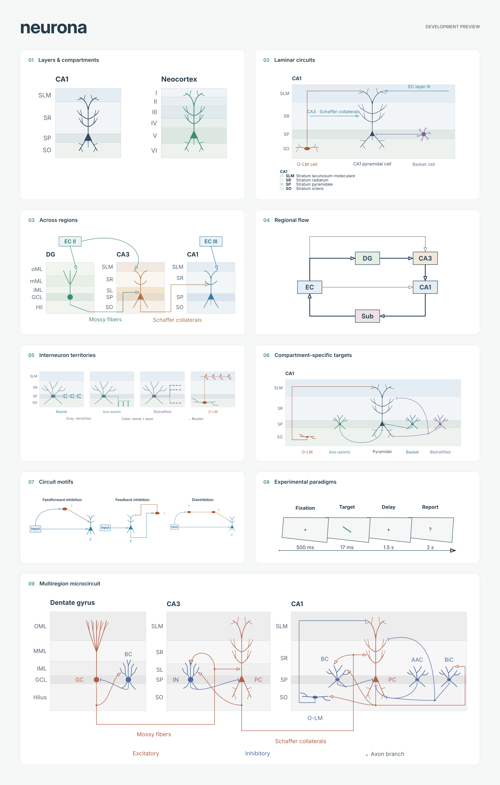
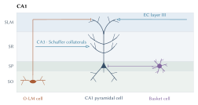

# neurona

A modular Typst toolkit for neuroscience schematics: experimental paradigms, stimulus sequences, schematic neurons, laminar organization, and compartment-specific circuit connections. The output is vector artwork, with native Typst labels. The original timeline API remains available.

[Documentation and visual gallery](https://kylekahraman.github.io/neurona/) · [Source](https://github.com/kylekahraman/neurona)

The documentation is built with Astro Starlight from [`docs/site/`](docs/site/README.md).

`neurona` is the new development name of this project, previously called `paradigm`. Cells, layers, circuits and experimental sequences remain modules of one package. The `paradigm()`, `stage()` and `timeline()` functions keep their names and behavior. Use a local import while this version is in development; no `@preview/neurona` release is implied.



## Smallest example

In a file beside `lib.typ`:

```typst
#import "lib.typ": circuit, neuron
#circuit(neurons: (neuron("pc"),))
```

For a small six-layer example, start with [quickstart.typ](examples/quickstart.typ). Simple figures use only a few constructors; complex circuits currently require explicit positions and routes. Initial interneuron and circuit-motif recipes are available; routing assistance is on the roadmap.

## Cell recipes and circuit motifs

```typst
#import "lib.typ": circuit, interneuron, motif
#circuit(neurons: (interneuron("olm", kind: "olm"),), width: 85mm)
#motif("feedforward", width: 60mm)
```

`interneuron` provides `basket`, `axo-axonic`, `bistratified` and `olm` schematic recipes with separate dendritic and axonal paths. `arbor: false` keeps a compact soma/dendrite drawing and axon source for explicitly authored connections. `motif` offers `feedforward`, `feedback` and `disinhibition`; `motif-scene` returns editable scene arguments for further composition with `circuit`.

See the [interneuron atlas](examples/interneuron-atlas.typ), [CA1 target compartments](examples/compartment-targets.typ), [motif comparison](examples/circuit-motifs.typ), and [recipe anatomy, sources and parameters](docs/cell-recipes.md). These extend the same renderer. The recipes are illustrative rodent CA1 domain drawings; they are not measured reconstructions and do not automatically adapt their arbors to changed layer heights.

See the [roadmap](ROADMAP.md) for cell presets, illustrative electrophysiology, morphology adapters and optional brain templates. The [reference classes](docs/reference-classes.md) group supplied examples by reusable drawing vocabulary.

## Laminar circuits (development preview)



```typst
#import "../lib.typ": band, region, site, neuron, projection, circuit

#circuit(
  width: 85mm,
  regions: (region("ca1", (
    band("so", label: [SO], height: 1.6),
    band("sp", label: [SP], height: 0.7),
    band("sr", label: [SR], height: 2.2),
    band("slm", label: [SLM], height: 1.4),
  ), width: 8),),
  neurons: (neuron("pc", at: site("ca1", "sp", 4)),),
  connections: (
    projection(site("ca1", "sr", 0.5), "pc.apical"),
  ),
)
```

The relative import above is for a document in this repository's `examples/` directory; adjust it to your local checkout. These APIs are a development preview, not a claim that a new release is available on Typst Universe.

Modules can also be imported as `experiments`, `cells`, `layers`, `circuits`, `presets` and `motifs` from `lib.typ`. They share one scene renderer and the CeTZ drawing backend. See the illustration-only examples: [CA1, 85 mm](examples/hippocampal-layers.typ), [DG-CA3-CA1, 125 mm](examples/hippocampal-pathways.typ), [laminar domains, 105 mm](examples/laminar-domains.typ), [regional wiring, 85 mm](examples/regional-network.typ), [the first multiregion microcircuit](examples/hippocampal-microcircuit.typ), and [the nine-page gallery](examples/illustrations.typ). Sources and feasibility are kept in [the reference notes](docs/visual-references.md), outside the illustrations.

| Function | Purpose |
| --- | --- |
| `band(id, label:, height:, fill:)` | One freely defined layer |
| `cortical-layers(numbering:, heights:, fills:)` | Optional six-layer neocortex data preset, I-VI or 1-6 |
| `layer-legend(regions, ...)` | Layer color keys and names, grouped by region |
| `region(id, bands, at:, width:, label:)` | An independent stack of layers, listed bottom-to-top in the figure |
| `site(region, layer, x, depth:)` | A position relative to a layer; `depth: 0` is its bottom and `1` its top |
| `neuron(id, at:, kind:, ...)` | A configurable `pyramidal`, `granule`, `stellate`, `horizontal`, `basket`, `bipolar`, or `custom` glyph |
| `neurite(points, controls:, boutons:, ...)` | An explicit cell-relative dendrite or axon path with optional terminal markers |
| `interneuron(id, kind:, arbor:, ...)` | A schematic rodent CA1 basket, axo-axonic, bistratified or O-LM drawing recipe |
| `motif(kind, width:, ...)` | Compact feedforward inhibition, feedback inhibition or disinhibition |
| `motif-scene(kind, ...)` | Ordinary editable scene arguments for composing a motif with `circuit` |
| `population(id, label, at:, ...)` | A labeled population/region box in the same scene |
| `junction(id, at:, radius:, color:)` | An explicit axon branch point with a named `center` anchor |
| `projection(source, target, effect:, ...)` | Explicit excitatory, inhibitory, or unspecified connection |
| `annotation(at, body, ...)` | A freely placed Typst label |
| `circuit(neurons:, regions:, populations:, connections:, annotations:, ...)` | Compose cells, laminar stacks and regional boxes on one canvas |

Positions and dimensions are in canvas units (`circuit(unit: 1cm)` by default). Cell geometry uses `apical`, `basal`, `spread`, and uniform `scale`. Layer sites move somata when the stack changes; dendrite lengths remain explicit and are not automatically fitted to layers. `label` and `label-offset` name a cell; `color`, `font-size`, and `line-width` control appearance. `cells.draw-neuron` can also be used inside a caller-owned CeTZ canvas.

`circuit(width: 85mm)` fits the complete artwork, including labels, to an exact physical width and preserves aspect ratio. This scales text and strokes as well as geometry. Use `unit` to change geometry while retaining the requested physical `font-size`, or use `width` to fit an already composed illustration. `detail: "minimal"` reduces branch density for compact panels. A cell's `orientation` rotates its drawing and ports around its soma; labels stay upright.

For built-in glyphs, `neuron(axon-origin: "top")` moves the default axon stub and its `axon` port to the top of the soma. `"left"`, `"right"` and the default `"bottom"` are also available. These directions are cell-local and follow rotation/scale; custom cell and interneuron recipes retain their explicitly authored axon paths.

`cortical-layers()` returns layers bottom-to-top, VI at the bottom and I at the top. `heights` and `fills` are supplied I-to-VI; `numbering: "arabic"` changes only labels. Stable IDs `l1`-`l6` work with `site`. Thicknesses are schematic; ordinary bands support agranular regions, merged layers and sublayers. This preset is not applied to the hippocampus.

`band(name: [Stratum pyramidale])` adds a legend name while retaining a short label such as `SP`. `circuit(legend: true, legend-columns: 2)` adds a legend using actual layer labels/colors, grouped separately for each region. It is included in the requested width. A standalone `layer-legend(regions)` is also available. `region(show-layer-labels: false)` hides edge labels while retaining legend entries. See [the CA1/neocortex example](examples/cortical-layers.typ).

Endpoints such as `"pc.soma-east"`, `"pc.axon"`, `"pc.proximal"`, `"pc.apical"`, `"pc.basal"`, `"pc.tuft"` and `"pc.tuft-west"` refer to compartments on the drawn cell. All glyphs expose `soma`, `soma-west` and `soma-east`; built-in glyphs also expose `axon` and `dendrite`. Pyramidal and granule glyphs expose `proximal`, `apical` and `tuft` anchors; only pyramidal glyphs expose `basal` and `ais` (the drawn axon initial segment). Population boxes expose `north`, `south`, `east`, `west`, `center` and the four diagonal anchors. IDs must be unique across cells and populations, contain no dots, and not use the reserved `__paradigm-` prefix.

For symbolic laminar atlases or author-defined morphology, use `kind: "custom"` with `dendrites: (neurite(...), ...)` and `axons: (...)`. Each path exposes its last point as `dendrite-0`, `axon-0`, etc. A path uses a polyline, or exactly two endpoints with one or two Bezier `controls`. `boutons` are explicit cell-relative positions; placing them off a neurite also draws them off the neurite. Use `color` and relative `thickness` per path to distinguish somatodendritic and axonal territories. Additional `ports: (tip: (x, y), ...)` share the cell's scale and rotation; they cannot overwrite existing ports. These are schematic paths, not measured SWC morphologies.

Use `effect: "inhibitory"` for a terminal bar, `"excitatory"` for an arrowhead, and `"unspecified"` for an unmarked line. `via: (...)` supplies polyline waypoints; `controls: (...)` supplies one or two Bezier handles. Both accept coordinates, layer sites, or cell anchors, and are mutually exclusive. `weight` changes relative line thickness without assigning a biological quantity. `dashed: true` is a visual convention chosen by the author. Edge labels accept `label-at` (0-1 along the path) and `label-offset`.

`projection(target-gap: 0.07)` leaves a small visual clearance before an arrow/bar target, in canvas units; the default is zero. The named compartment remains fixed. This applies to marked excitatory/inhibitory connections; unmarked paths retain their full length. It does not route around other cells or dendrites automatically.

Use `circuit(junctions: (junction("branch", at: (2, 1)),), ...)` and `"branch.center"` to author a common axon stem and separate terminal branches. The [multiregion scene](examples/hippocampal-microcircuit.typ) demonstrates DG/CA3/CA1 layers, nine cells and selected excitatory/inhibitory loops; its [scope and sources](docs/hippocampal-microcircuit.md) distinguish this first composition from the full Figure 7.1B reference.

Layer fills are fully configurable: `band("sr", fill: rgb("eeeeee"))` creates a grey band, and `cortical-layers(fills: (rgb("fafafa"), rgb("f2f2f2"), rgb("e8e8e8"), rgb("dddddd"), rgb("d0d0d0"), rgb("c4c4c4")))` supplies six greys in I-to-VI order. Cell and projection colors are independent.

Built-in cell dimensions and detail are configurable, but their default branching patterns have fixed branch counts. `neuron(dendrites: ...)` adds explicit paths to a built-in glyph; `kind: "custom"` uses only the supplied paths. `interneuron` recipes currently have fixed dendritic recipes: their returned records can be edited to replace `dendrites` and update the corresponding `ports`. Neither constructor yet has an arbitrary branch-count parameter. See [recipe customization](docs/cell-recipes.md).

Glyphs are schematic. A glyph's shape does not establish cell type, transmitter, molecular markers, or connectivity. Crossings do not imply synapses. The toolkit does not infer connections from neurite overlap. The CA1 example shows selected rodent pathways with sources; it does not provide a complete or quantitatively scaled anatomical template. Four sourced interneuron domain recipes provide an initial atlas. Automatic routing, reconstructed morphologies and a broader anatomical recipe library remain future work.

## Quick start

```typst
#import "lib.typ": paradigm, stage, timeline

#figure(
  paradigm((
    stage("Fixation", duration: "1 s", display: [•]),
    stage("Target", duration: "17 ms", display: [■]),
    stage("ISI", duration: "17 ms", display: [•]),
    stage("Mask", duration: "233 ms", display: [⋅  ⋅  ⋅\ ⋅  •  ⋅\ ⋅  ⋅  ⋅]),
    stage("Delay", duration: "1.5 s", display: [•]),
    stage("Response", duration: "2 s", display: [Vu?]),
  )),
  caption: [Example visual working-memory task],
)
```

## API

- `stage(title, ...)` describes an event or phase. Use `display` for any Typst content.
- `paradigm(stages, ...)` is the quick path for an experimental sequence of display panels.
- `timeline(stages, layout: ...)` selects `"panels"`, `"axis"`, or `"lanes"`.
- Panel `spacing: "equal"` keeps every stage the same width. `spacing: "proportional"` scales widths to numeric `duration` values in seconds; use `duration-label` to control the printed label.
- For `"axis"` and `"lanes"`, provide numeric `start` and `end` times in seconds. Overlapping intervals are supported. Give each parallel track a `lane` name.
- Panel shapes can be selected globally with `panel: "perspective"`, `"rectangle"`, `"diamond"`, `"circle"`, or `"none"`; a stage can override that with `shape:`.
- `stage-width`, `stage-height`, `time-width`, `gap`, `header-gap`, and `timing-gap` tune layout dimensions in cm. `arrow`, `stroke`, `fill`, `font-size`, and `line-width` tune appearance.

The easiest path needs only a list of stages and their display labels. Use numeric seconds when exact spacing matters, and use `display` for custom stimuli or illustrations. Extremely short stages can become too narrow to hold labels or artwork in proportional panels; use the time-axis layout for large differences in duration. See [the equal-spacing example](examples/working-memory.typ), [proportional panels](examples/proportional.typ), [time axis](examples/axis.typ), and [parallel lanes](examples/lanes.typ).

## Development

Compile examples from this directory:

```sh
typst compile --root . examples/working-memory.typ /tmp/neurona.pdf
typst compile --root . examples/proportional.typ /tmp/neurona-proportional.pdf
typst compile --root . examples/axis.typ /tmp/neurona-axis.pdf
typst compile --root . examples/lanes.typ /tmp/neurona-lanes.pdf
typst compile --root . examples/hippocampal-layers.typ examples/hippocampal-layers.pdf
typst compile --root . examples/hippocampal-layers.typ examples/hippocampal-layers.svg
typst compile --root . examples/neurons.typ /tmp/neurona-neurons.pdf
typst compile --root . examples/illustrations.typ examples/illustrations.pdf
typst compile --root . showcase.typ showcase.png --ppi 180
python3 tests/check.py
```

The package uses [CeTZ](https://cetz-package.github.io/) for vector drawing.

## Additional cell shapes

The [cell atlas](examples/cell-atlas.typ) demonstrates the shared `neuron`,
`projection` and `circuit` API, including basket-like and bipolar glyphs.
`basket` exposes `dendrite-top`, `dendrite-left` and `dendrite-right`;
`bipolar` exposes `dendrite-top` and `dendrite-bottom`. Both also expose the
standard `dendrite`, `axon`, `soma`, `soma-west` and `soma-east` ports.
`apical` and `basal` control upper/lower arbor extents; `spread` controls width.
All ports follow geometry changes, `scale` and `orientation`.

These are morphology drawing templates. Basket-like shape does not establish
PV identity, and bipolar shape does not establish VIP identity. Draw a
basket-like axon territory explicitly with `axons` or `projection` rather than
inferring contacts from the glyph.
